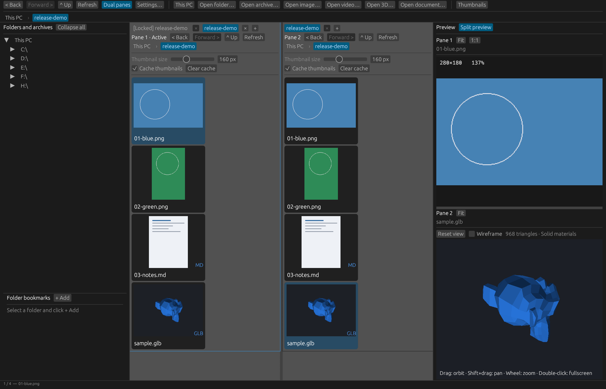

# view-calipers

A Windows media browser for images, videos, comics, documents, and 3D models. Explore folders and archives, compare files in two panes, and keep frequently used locations close at hand.



## Features

- **Browse from This PC:** an always-available drive and folder tree, clickable breadcrumbs, Back / Forward / Up navigation, and folder bookmarks.
- **Two independent panes:** browse different locations, resize the divider, and use tabs in each pane. Duplicate, lock, or close tabs; navigating away from a locked tab opens a new one.
- **Split preview:** compare Pane 1 above Pane 2 with an adjustable horizontal divider. Both video previews can play simultaneously with independent controls.
- **Thumbnail gallery:** adjustable thumbnail size, folder and archive covers, natural filename sorting, background generation, and optional persistent disk caching.
- **Images:** automatic EXIF rotation and mirroring, fit and actual-size views, cursor-centered zoom, panning, and fullscreen viewing.
- **Archives and comics:** browse images in ZIP / CBZ, RAR / CBR, and 7z / CB7, including nested folders, without unpacking the whole archive.
- **Microsoft Visual C++ Redistributable (x64):** the executable uses the MSVC runtime. Install the [latest supported v14 Redistributable](https://learn.microsoft.com/en-us/cpp/windows/latest-supported-vc-redist) if it is missing.
- **Video:** playback, audio / mute, responsive seeking and scrubbing, whole-clip repeat, and draggable A–B range markers. Optional GPU decoding falls back to software when unsupported.
- **PDF and Markdown:** rendered PDF pages with a page timeline and scrubbing, and formatted Markdown previews.
- **3D:** OBJ, FBX, glTF / GLB, and USD-family files with GPU-rendered orbit, pan, zoom, solid / wireframe views, and cached geometry.
- **Custom shortcuts:** change keyboard bindings and viewing preferences in Settings.

## Download and run

Download the Windows x64 ZIP from [Releases](https://github.com/baborub/view-calipers/releases), extract it, and run `view-calipers.exe`. No application installer is required.

The first release is `v0.1.0`. The application is unsigned.

### Requirements

- Windows 10 / 11, x64, with a graphics driver supporting OpenGL 3.3.
- **Microsoft Visual C++ Redistributable (x64):** the executable uses the MSVC runtime. Install the [latest supported v14 Redistributable](https://learn.microsoft.com/en-us/cpp/windows/latest-supported-vc-redist) if it is missing.
- **Video:** FFmpeg, FFprobe, and FFplay. Install a build containing all three, or place `ffmpeg.exe`, `ffprobe.exe`, and `ffplay.exe` in a `tools` folder next to the application. The app also detects the installed Gyan.FFmpeg WinGet package and checks PATH.
- **3D:** Blender 4.x or newer with the corresponding format importers available. Blender installations under `Program Files\Blender Foundation` are detected automatically. For other locations, set `BLENDER_PATH` to the full path of `blender.exe`.
- Images, comics, PDF, and Markdown do not require FFmpeg or Blender. PDF rendering uses the Windows PDF API.

FFmpeg and Blender are external dependencies and are not included in the release ZIP.

## Supported files

| Category | Extensions |
| --- | --- |
| Images | JPG, JPEG, PNG, GIF, WebP, BMP, TIFF, TGA, EXR, HDR, ICO, PNM, PBM, PGM, PPM, QOI, DDS |
| Video | MP4, MKV, AVI, MOV, WebM, M4V, WMV, MPG, MPEG, TS, MTS, M2TS, FLV, OGV |
| Archives / comics | ZIP, CBZ, RAR, CBR, 7z, CB7 |
| Documents | PDF, MD, Markdown |
| 3D | OBJ, FBX, glTF, GLB, USD, USDA, USDC, USDZ |

Video codec support depends on the installed FFmpeg build. Archives currently expose images; videos, documents, and 3D models should be opened from the filesystem.

## Quick start

1. Expand a drive in the folder tree or drag a folder or file into the window.
2. Select a folder or archive to display its contents as thumbnails.
3. Click a file to preview it; double-click its thumbnail or preview for fullscreen.
4. Turn on **Dual panes** for independent browsing. Turn on **Split preview** to see both selected files at once.
5. Use **+** to create a tab. Right-click a tab to duplicate, lock / unlock, or close it. A locked tab keeps its location and cannot be closed until unlocked.
6. Use **Folder bookmarks → + Add** for quick access to the current folder.

### Default shortcuts

| Action | Shortcut |
| --- | --- |
| Next / previous file or PDF page | Right / Left, Page Down / Page Up |
| First / last file or PDF page | Home / End |
| Fit / reset 3D view | F |
| Actual image size | 1 |
| Play / pause active video | Space |
| Fullscreen | F11 or double-click |
| Exit fullscreen | Escape |
| Back / forward / parent | Alt+Left / Alt+Right / Alt+Up |
| Dual panes / switch active pane | F6 / Tab |
| New / close / duplicate tab | Ctrl+T / Ctrl+W / Ctrl+D |
| Lock / unlock tab | Ctrl+Shift+L |
| Settings | Ctrl+, |

Scroll to zoom and drag to pan images. In 3D, drag to orbit, Shift+drag to pan, and scroll to zoom. Orbit directions and sensitivity are configurable.

### Video ranges

Drag the playhead to seek or scrub. Move the A and B markers to select a section, enable the A–B range, then enable Repeat to loop that section. Without an enabled range, Repeat loops the whole clip. Each split preview has its own playback, range, repeat, and mute state. Space controls the active pane. Hiding the second preview pauses its video.

## Settings and cache

For compatibility with earlier builds, local data remains under `%LOCALAPPDATA%\ArchView`:

- `settings.conf`: viewing preferences and keyboard bindings.
- `bookmarks.txt`: folder bookmarks.
- `thumbnails-v1`: thumbnail PNGs and cached 3D geometry.

Thumbnail keys account for the source path, archive entry, size, modification time, and cache format version. Use **Clear cache** to rebuild cached previews. Navigation histories and tabs are session-only. Original media files are not modified.

## Current limits

- Windows x64 only; no macOS or Linux release.
- Video preview decoding is capped at approximately 960 × 540 pixels and 24 fps. Portrait aspect ratios and rotation metadata are preserved.
- Animated image formats currently show a still image.
- 3D previews show mesh geometry and base material colors, without textures or animation. The preview limit is 2 million triangles; importer support depends on Blender.
- Password-protected archives are not supported.
- Tabs, their locks, and playback ranges are not restored across application restarts.

## Build from source

Install stable Rust with the MSVC toolchain and Visual Studio C++ build tools, then run in PowerShell:

```powershell
cargo build --release --locked
.\target\release\view-calipers.exe
# Optional initial path:
.\target\release\view-calipers.exe "D:\Pictures"
```

To run the complete test suite, install FFmpeg / FFprobe / FFplay and Blender first:

```powershell
cargo test --release --locked
```

The CI workflow runs the suite excluding the four integration tests requiring those external tools. See [CONTRIBUTING.md](CONTRIBUTING.md) and [the release guide](docs/PUBLISHING.md).

## License

The application source is licensed under [MIT](LICENSE). Dependencies retain their own licenses. See [THIRD_PARTY.md](THIRD_PARTY.md), the bundled license texts, and [UnRAR-LICENSE.txt](UnRAR-LICENSE.txt) for UnRAR's additional conditions. FFmpeg and Blender are installed separately and retain their own licenses.


