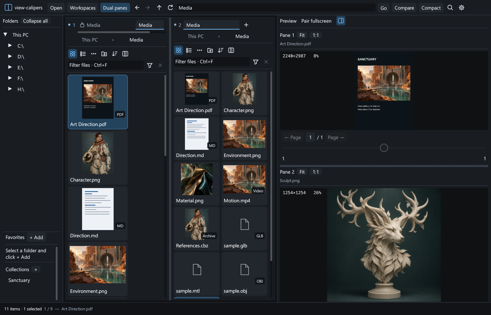
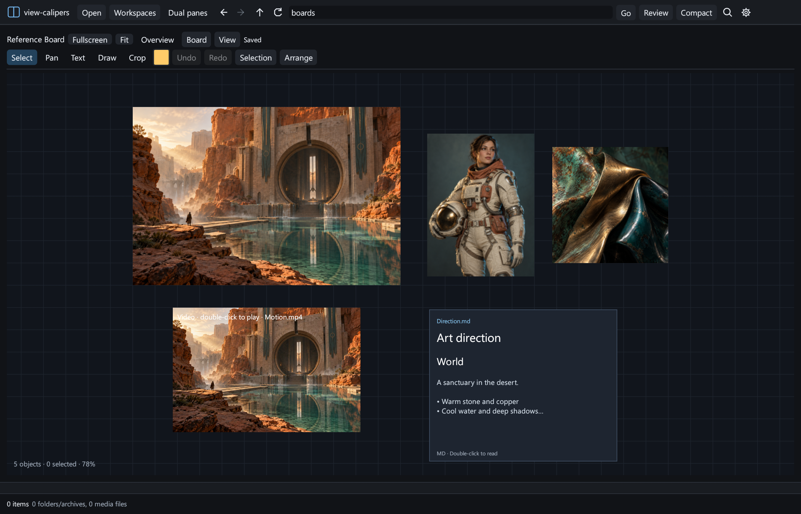

# view-calipers

A fast, native Windows media viewer and reference canvas for artists, built with Rust + egui. Browse images, videos, comics, PDF, Markdown and 3D models; compare files in two panes; arrange references on an infinite canvas without duplicating your local files.



## Features



Screenshots show the actual application with generated demonstration artwork.

- **Collection canvases:** click a collection to pin an infinite canvas below the file preview, in single or dual pane mode. Move, scale and rotate images, videos and formatted Markdown cards; add notes and drawings. Play multiple clips independently and open Markdown in a full reader. Drag from either pane, archives or a browser, and paste copied images. Each collection has its own folder and autosaved canvas. [Controls and storage](docs/REFERENCE_BOARDS.md).
- **Reference tools:** pack and align references, normalize their sizes, organize named groups, lock objects and snap to a grid. Crop, mirror, fade and view images/videos in grayscale without modifying originals. Focus a reference, keep the window on top, or right-click to duplicate it and reveal its source in a file pane.
- **Modern workbench:** Compact / Comfortable density, unified icons and colors, Browse / Compare / Review layouts, a review filmstrip, and command search (Ctrl+Shift+P). Panel widths and layout preferences persist between launches.

- **Browse from This PC:** an always-available drive and folder tree, clickable breadcrumbs, Back / Forward / Up navigation, and folder bookmarks.
- **Named workspaces:** save and restore tabs in both panes, folders and collections, selected files, locked tabs, local filters, per-tab views and sorting, panel widths, and split preview. Use Workspaces → Save workspace as… or Manage workspaces to update, rename, or delete a snapshot.
- **Two independent panes:** browse different locations, resize the divider, and use tabs in each pane. Duplicate, lock, or close tabs; navigating away from a locked tab opens a new one.
- **Pair fullscreen:** enable the toggle at the top of Preview while using split preview. Double-click either preview to display Pane 1 on the left and Pane 2 on the right. Each half has independent navigation, zoom and media controls; Escape returns to the regular layout.
- **Split preview:** compare Pane 1 above Pane 2 with an adjustable horizontal divider. Both video previews can play simultaneously with independent controls.
- **Thumbnail gallery:** adjustable thumbnail size, folder and archive covers, natural filename sorting, background generation, and optional persistent disk caching.
- **Images:** automatic EXIF rotation and mirroring, fit and actual-size views, cursor-centered zoom, panning, and fullscreen viewing.
- **Archives and comics:** browse images in ZIP / CBZ, RAR / CBR, and 7z / CB7, including nested folders, without unpacking the whole archive.
- **Video:** playback, audio / mute, responsive seeking and scrubbing, whole-clip repeat, and draggable A–B range markers. Optional GPU decoding falls back to software when unsupported.
- **PDF and Markdown:** rendered PDF pages with a page timeline and scrubbing, and formatted Markdown previews.
- **3D:** OBJ, FBX, glTF / GLB, and USD-family files with GPU-rendered orbit, pan, zoom, solid / wireframe views, and cached geometry.
- **Custom shortcuts:** change keyboard bindings and viewing preferences in Settings.

## Download and run

Download the Windows x64 ZIP from [Releases](https://github.com/baborub/view-calipers/releases), extract it, and run `view-calipers.exe`. No application installer is required.

Current release: **[v0.5.0](https://github.com/baborub/view-calipers/releases/tag/v0.5.0)**. The application is unsigned. Release archives include license notices and a SHA-256 checksum.

### Requirements

- Windows 10 / 11, x64, with a graphics driver supporting OpenGL 3.3.
- **Microsoft Visual C++ Redistributable (x64):** the executable uses the MSVC runtime. Install the [latest supported v14 Redistributable](https://learn.microsoft.com/en-us/cpp/windows/latest-supported-vc-redist) if it is missing.
- **Video:** FFmpeg, FFprobe, and FFplay. Install a build containing all three, or place `ffmpeg.exe`, `ffprobe.exe`, and `ffplay.exe` in a `tools` folder next to the application. The app also detects the installed Gyan.FFmpeg WinGet package and checks PATH.
- **3D:** Blender 4.x or newer with the corresponding format importers available. Blender installations under `Program Files\Blender Foundation` are detected automatically. For other locations, set `BLENDER_PATH` to the full path of `blender.exe`.
- Images, comics, PDF, and Markdown do not require FFmpeg or Blender. PDF rendering uses the Windows PDF API.

FFmpeg and Blender are external dependencies and are not included in the release ZIP.

## Supported files

| Category | Extensions |
| --- | --- |
| Images | JPG, JPEG, PNG, GIF, WebP, BMP, TIFF, TGA, EXR, HDR, ICO, PNM, PBM, PGM, PPM, QOI, DDS |
| Video | MP4, MKV, AVI, MOV, WebM, M4V, WMV, MPG, MPEG, TS, MTS, M2TS, FLV, OGV |
| Archives / comics | ZIP, CBZ, RAR, CBR, 7z, CB7 |
| Documents | PDF, MD, Markdown |
| Reference boards | VCBOARD |
| 3D | OBJ, FBX, glTF, GLB, USD, USDA, USDC, USDZ |

Video codec support depends on the installed FFmpeg build. Archives currently expose images; videos, documents, and 3D models should be opened from the filesystem.

## Quick start

1. Expand a drive in the folder tree or drag a folder or file into the window.
2. Select a folder or archive to display its contents as thumbnails.
3. Click a file to preview it; double-click its thumbnail or preview for fullscreen.
4. Turn on **Dual panes** for independent browsing. Turn on **Split preview** to see both selected files at once.
5. Use **+** to create a tab. Right-click a tab to duplicate, lock / unlock, or close it. A locked tab keeps its location and cannot be closed until unlocked.
6. Use **Favorites → + Add** for quick access to the current folder.

### Default shortcuts

| Action | Shortcut |
| --- | --- |
| Next / previous file or PDF page | Right / Left, Page Down / Page Up |
| First / last file or PDF page | Home / End |
| Fit / reset 3D view | F |
| Actual image size | 1 |
| Play / pause active video | Space |
| Fullscreen | F11 or double-click |
| Exit fullscreen | Escape |
| Back / forward / parent | Alt+Left / Alt+Right / Alt+Up |
| Dual panes / switch active pane | F6 / Tab |
| New / close / duplicate tab | Ctrl+T / Ctrl+W / Ctrl+D |
| Lock / unlock tab | Ctrl+Shift+L |
| Settings | Ctrl+, |
| Search commands | Ctrl+Shift+P |
| Delete selected files / folders | Delete |

Wheel over a preview browses files (down: next, up: previous); Ctrl+wheel zooms, and dragging pans images. In 3D, drag to orbit, Shift+drag to pan, and Ctrl+wheel to zoom. Orbit directions and sensitivity are configurable.

### Media performance

Opaque photos upload directly from decoded RGBA buffers into native OpenGL textures. The full mip pyramid is allocated before upload and generated on the GPU for smooth reduction. Transparent images retain the premultiplied-alpha path. The shared GPU budget includes mip levels; decoded photo pixels remain cached in RAM.

JPEG thumbnails use reduced-resolution decoding before resizing, with EXIF rotation and mirroring preserved. Unsupported JPEG variants fall back to the standard decoder. Background thumbnail generation uses 1–4 workers per pane depending on CPU availability; existing disk caches remain valid.

Video playback and scrubbing use YUV420 frames with GPU color conversion and reused plane textures. Frame deadlines and decoder notifications drive redraws. The shared scrub cache stores the same YUV layout, using approximately half the payload memory of RGB24. Scrubbing reuses an open FFmpeg decoder for nearby forward positions and caches eight recent frames for backward movement. Large jumps or backward positions outside the cache restart the decoder. Scrub output is a single latest-result slot, so obsolete requests cannot overwrite the current seek position. Poster and scrub frames no longer pass through PNG compression.

On high-memory systems, a shared **8 GiB scrub RAM cache** is enabled by default together with background video preloading. Systems with 32 GiB RAM default to 2 GiB, and smaller / unknown systems to 512 MiB with preloading off. **Settings → Video performance** controls the 0–32 GiB budget, background preload, NVIDIA CUDA resize / decode, and cache clearing. RAM usage and preload activity appear in Settings → Video performance.

Preloading samples approximately two frames per second across the clip. Dragging may immediately show a nearby cached frame (up to roughly 0.26 s away), followed by a precise result; releasing the playhead always requests its exact normalized frame. Two jobs may run simultaneously. Sparse preload uses up to 75% of the shared budget, leaving room for foreground frames. Large clips can exceed capacity; uncached positions still use the live decoder. The cache is in-process and is cleared when the application exits.

CUDA preloading selects sparse frames before GPU resizing / download, so only those preview frames cross into CPU memory. Unsupported codecs / CUDA builds and rotated clips use the CPU path. This profile does not change the playback resolution cap.

Local benchmark results and reproduction commands are in [Media performance](docs/MEDIA_PERFORMANCE.md). Hardware decoding still transfers frames through CPU memory before the OpenGL texture upload; direct GPU texture sharing is a separate future backend change.

### Video ranges

Drag the playhead to seek or scrub. Move the A and B markers to select a section, enable the A–B range, then enable Repeat to loop that section. Without an enabled range, Repeat loops the whole clip. Each split preview has its own playback, range, repeat, and mute state. Space controls the active pane. Hiding the second preview pauses its video.

## Settings and cache

For compatibility with earlier builds, local data remains under `%LOCALAPPDATA%\ArchView`:

- `settings.conf`: viewing preferences and keyboard bindings.
- `bookmarks.txt`: folder bookmarks.
- `thumbnails-v1`: thumbnail PNGs and cached 3D geometry.

Thumbnail keys account for the source path, archive entry, size, modification time, and cache format version. Use **Clear cache** to rebuild cached previews. Navigation histories and tabs are session-only unless saved in a named workspace. Previewing files and arranging references do not modify the originals; file management commands act on the selected files.

## Current limits

- Windows x64 only; no macOS or Linux release.
- Video preview decoding is capped at approximately 960 × 540 pixels. Playback follows the reported average source frame rate (up to 120 fps; 24 fps fallback). Variable-rate sources are normalized to that rate. Portrait aspect ratios and rotation metadata are preserved.
- Animated image formats currently show a still image.
- 3D previews show mesh geometry and base material colors, without textures or animation. The preview limit is 2 million triangles; importer support depends on Blender.
- Password-protected archives are not supported.
- Tabs, their locks, and playback ranges are not restored across application restarts.

## Build from source

Install stable Rust with the MSVC toolchain and Visual Studio C++ build tools, then run in PowerShell:

```powershell
cargo build --release --locked
.\target\release\view-calipers.exe
# Optional initial path:
.\target\release\view-calipers.exe "D:\Pictures"
```

To run the complete test suite, install FFmpeg / FFprobe / FFplay and Blender first:

```powershell
cargo test --release --locked
```

The CI workflow runs the suite excluding the four integration tests requiring those external tools. See [CONTRIBUTING.md](CONTRIBUTING.md) and [the release guide](docs/PUBLISHING.md).

## License

The application source is licensed under [MIT](LICENSE). Dependencies retain their own licenses. See [THIRD_PARTY.md](THIRD_PARTY.md), the bundled license texts, and [UnRAR-LICENSE.txt](UnRAR-LICENSE.txt) for UnRAR's additional conditions. FFmpeg and Blender are installed separately and retain their own licenses.


### File management

Use **Actions** or right-click a selected item for Copy, Cut, Paste, Duplicate, Rename and transfers to the other pane. These operations work on filesystem files and folders, including file types without previews. Archive contents are read-only; the archive itself can be managed from its parent folder.

- Single-click selects an item and previews supported media; double-click opens folders/archives or fullscreen media.
- Ctrl-click selects multiple items; Shift-click selects a range; Ctrl+A selects all. Drag from empty space to select a rectangle in Thumbnails or Details. Ctrl / Shift add to the existing selection; Escape cancels the rectangle.
- Ctrl+C / Ctrl+X / Ctrl+V use the Windows file clipboard and work with Explorer.
- Ctrl+Shift+D duplicates selected files; F2 renames one item. Ctrl+D still duplicates a tab.
- **Copy to other pane** and **Move to other pane** target the folder open in the other pane. Drag selected files onto the other pane, a folder tile, or a folder in the tree on the left; hold Ctrl to copy, otherwise move. The destination is highlighted.
- **Delete** (configurable in Settings) or **Actions → Delete** asks for confirmation and uses the Windows Recycle Bin. Windows prompts separately if a volume cannot recycle and would permanently delete an item. Drive roots, links and junctions are rejected.
- **Details** / **Thumbnails** switches each tab's view. F4 toggles the active tab's view. Details includes size and creation time in local time; scroll horizontally in narrow panes.
- Paste a folder or file path into the top address field and press Enter or Go. Ctrl+L focuses the address bar. Quoted paths and relative paths inside the current folder are accepted.
- Shortcuts can be changed in Settings. Existing destination names are never replaced; copies/transfers receive a ` - Copy` suffix when needed. Rename rejects existing names. Cross-drive moves remove the source only after the copy succeeds; a failed copy retains the source and may leave a partial destination identified in the error message.

Links and junctions are not copied or moved by the file manager. Background jobs report errors in the status bar; hover to read the full message.

### Workbench

Use the **Browse / Compare / Review** menu in the top bar to change your workspace. Browse shows one file pane and its preview. Compare shows two independently navigable file panes and two previews. Review gives the active pane a large preview and a horizontal filmstrip. Folder sidebar and preview visibility are available in the same menu.

Choose **Compact** for dense collections or **Comfortable** for larger controls and spacing. Settings also exposes density and visibility. Tabs support the same lock, duplicate and close actions through their context menu. **Ctrl+Shift+P** opens command search; use arrow keys, Enter and Escape. Narrow pane toolbars keep transfer actions and thumbnail size inside **Actions**. Thumbnail cache controls are in **Settings → Viewing**.

The interface reads Segoe UI from the Windows font directory at runtime; the font is not bundled.

Fullscreen file navigation: click or drag the Files slider below the preview. Hover it for a thumbnail of the target file. Paired fullscreen has an independent slider for each folder and a draggable divider (double-click to reset).

Photo acceleration: full-resolution photo decoding runs in the background. Neighboring photos are cached in RAM and GPU textures are reused between panes and tabs. Settings → Photo performance controls preloading, shared memory budgets and clearing. The high-memory default is 4096 MB RAM and 1024 MB estimated RGBA texture memory; current previews, in-flight decode buffers and graphics-driver overhead are additional. GPU scaling/rendering remains OpenGL; photo decompression runs on the CPU.

## Search and filtering

Press **Ctrl+F** in a pane. **Filter** searches the displayed folder without extra software. Use the type selector, words, quoted phrases, `*` / `?` masks, `!exclude`, and `|` for OR. Examples: `ext:jpg;png size:>10MB`, `dm:>=2026-01-01`, `dc:<2026-10-01`, or `regex:^shot_[0-9]+`. The Regex checkbox treats the entire query as a regular expression.

Choose **Everything** for indexed search across drives, or **Folder + subfolders** for recursive indexed search. This requires the [Everything desktop application](https://www.voidtools.com/) to be installed, running, and indexed. Its full native query syntax is supported. The official MIT-licensed x64 SDK is embedded; no SDK installation is needed. **Start Everything** launches an existing installation if the client is stopped.

Search runs in the background, with 200 results per page and thumbnails/previews. The context menu offers **Show in folder**; normal file operations use the original file paths. Paste into an ambiguous global result list is disabled; target a folder or the other pane instead. **Saved** stores reusable searches. Each pane/tab has its own search state. Clearing a global search returns to its original folder.

### Folder creation and sorting

Use **+ New folder**, **Actions → New folder**, or **Ctrl+Shift+N** inside a filesystem folder. Enter a name and choose **Create**. Existing folders are never overwritten.

Click a details column to sort, then click it again to reverse the order. The **Sort** menu offers Name, Type, Size, Created, Modified, and Ascending/Descending in both Details and Thumbnails. Each tab keeps its sort while navigating and switching views; local folders stay first. Everything sorts all matching results before paging.

### Remembered folder views and columns

Folder views are saved automatically to `%LOCALAPPDATA%/ArchView/folder-views.tsv`. Each folder remembers Details/Thumbnails, sorting, thumbnail size, column widths, order, and visibility across visits and restarts. Search-result layouts do not overwrite the original folder view.

Drag a details header to reorder it. Drag its right edge to resize; double-click the edge to reset its width. Use **Columns** to show/hide columns, move them left/right, or reset the layout. Name stays visible.

### Collection canvases

Use **Collections → +** to create a named canvas. It is stored at `Documents\view-calipers\Name\Name.vcboard`, beside its imported images. Click its name to pin it below the current file preview, even with Dual panes off. Click empty space below the collection names to deselect. File browsing and tab changes keep the canvas open.

Drag images, local videos and Markdown files from either pane or Explorer onto the canvas. Double-click a video to play/pause; select it for scrubbing, mute, loop and A–B controls. Double-click a Markdown card for a full reader. Archives and browser drops support images. Local files remain references; browser images and pasted bitmaps are saved inside the collection folder. **Selection → Copy files into collection folder** makes owned copies of existing references. `.vcboard` files are hidden in browser panes.

Rename a collection or show its folder from its sidebar context menu. **Settings → Collections** changes the library folder by copying it to an empty destination; the previous copy is kept. Existing collections and layouts migrate automatically without removing legacy data. [Full canvas guide](docs/REFERENCE_BOARDS.md).

The left sidebar uses vertical scrolling only. Long names remain intact and are clipped at the panel edge; widen the sidebar to reveal more text.

### Saved workspaces

Open **Workspaces → Save workspace as…** to name the current setup. Select a saved name from the menu to restore it. **Manage workspaces** provides Restore, Update (replace the snapshot with the current setup), Rename, and Delete.

Snapshots are stored in `%LOCALAPPDATA%\ArchView\workspaces`. They refer to original locations and collection IDs without copying media. Missing folders, drives, archives, or deleted collections fall back to This PC with a warning. Media previews reopen paused; fullscreen and running Everything searches are not resumed. Local folder filters are saved. Restoration preserves your current performance settings and keyboard shortcuts. Workspaces are restored explicitly from the menu; they do not replace ordinary startup behavior.

Pane controls use two compact rows. **…** opens file actions, the folder-plus icon creates a folder, the sort icon opens sorting on narrow panes, and the columns icon configures Details columns. On very narrow panes, New folder and Columns are available under **…**. The funnel beside the search field opens search scope, file type, Regex, saved searches, and help. On wider panes, scope and type remain visible beside the input. Scrollbars stay visible and widen on hover.
